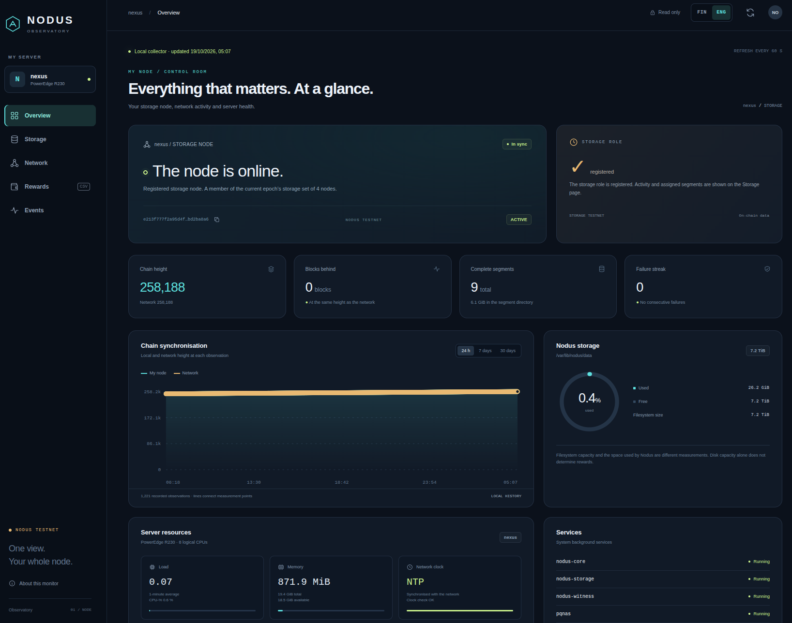

# Nodus Observatory

**English** · [Suomi](README_fin.md)



A local dashboard for a Nodus storage node: chain synchronisation, archive
segments, network status, server resources, events and a separate reward ledger
with annual summaries and CSV exports.

## Features and compatibility

- Monitoring pages: **Overview, Storage, Network, Rewards and Events**.
- This experimental branch adds **Contract Studio**: local document hashing,
  wallet-based registration and read-only registry lookup. The visual escrow
  editor remains available as an example. See the [document guide](docs/document-notary.md)
  and [escrow guide](docs/contract-studio.md).
- **FIN / ENG** controls for the complete interface, including charts, tooltips,
  dialogs, accessibility labels and errors. The browser remembers your choice.
- A systemd collector that normally samples once a minute, with a read-only web
  server bound to **127.0.0.1:8890** by default.
- Charts based on recorded observations. Missing measurements remain missing;
  stale data and collection failures are shown explicitly.
- Owner-wallet reward accounting for staking, storage and witness payouts,
  automatic historical imports from public Scan, separate stake returns, optional
  documented EUR valuations and source coverage. Missing prices remain unknown.
- A static demo in `dist/` with **synthetic sample data**. Its identifiers,
  measurements and events describe no real server or wallet. Demo JSON files
  are excluded from live installations.

The initial release is **1.0.0**. The CLI and accounting source contracts were
tested against **Nodus 0.26.7 testnet**, upstream commit
`24f93e6b709119a3013efacf3a374930c97871b7`. Other Nodus versions may change CLI
output or database schemas; unknown fields are left unknown.

This is the monitoring application, not the Nodus node source repository. It
contains no private identity keys or wallet credentials. Each installation
discovers its own public node identity and uses its own local configuration.

## Contract Studio experiment — this branch only

`feature/contract-studio` is a separate experiment and has not been merged into
`main`. Its document workflow hashes files locally (SHA-256, up to 64 MiB),
prepares actual registry ABI/bytecode and wallet inputs, and looks up records
through a bounded read-only local-node query. Files and private keys are never
uploaded. A result reports a record in a chosen publisher's registry namespace;
it does not establish authorship, truth or independently verified chain inclusion.
The deployed contract code is not automatically authenticated by the current CLI.
See [document registration and verification](docs/document-notary.md).

The **Escrow example** preserves the earlier bounded state machine: buyer deposit,
buyer approval, seller withdrawal, expiry refund and cancellation before funding.
Dragging states changes the layout; editing connections changes the graph that
is checked before code can be exported. Unsupported or incomplete graphs are
reported instead of silently producing a different contract.

The editor and simulator run locally in the browser. They do not read keys,
sign transactions, move coins or add write endpoints to the monitoring server.
The simulation is a model, not execution by a chain node. The separate offline
compiler helper produces ABI and bytecode only when an actual Nodus compiler is
provided. The document template also ships reproducibly compiled artifacts.
Review and publish contracts and registration calls in the Nodus wallet separately.
Selecting a file or downloading a reference JSON does not register anything.

To try this branch in a separate checkout:

```bash
git clone --branch feature/contract-studio \
  https://github.com/Trader1976/nodus-observatory.git nodus-observatory-studio
cd nodus-observatory-studio
sudo bash backend/install.sh
```

This updates the installed monitor to the experiment. Follow the
[studio guide](docs/contract-studio.md) for the editor, compiler, tests and limits.

## Requirements

- Debian/Ubuntu with systemd and an existing, running Nodus node.
- Python 3.10 or newer, standard library only. Ubuntu 24.04 is a tested platform.
- Git and administrative access for installation and updates.
- `nodus-cli`, `findmnt` and `lsblk` for automatic node/filesystem discovery.
- Optional `smartctl` (`smartmontools`) for supported physical-disk health data.

The frontend has no build step, external fonts or CDN dependencies. Node.js 22
is needed only for development checks, not on the monitoring server.

## Install

Run on the node server:

```bash
git clone https://github.com/Trader1976/nodus-observatory.git
cd nodus-observatory
sudo bash backend/install.sh
```

A fresh install reads public information from `nodus-cli status` and filesystem
information from `findmnt` / `lsblk`. It discovers the local fingerprint, data
directory, mount and a directly identifiable physical disk. Data on the root
filesystem is supported; a dedicated partition or particular disk capacity is
optional. Network measurements follow the default route unless configured
otherwise. Automatic SMART discovery for LVM/RAID or ambiguous devices remains
unknown.

The installer validates settings before changing services. Put node data under a
system directory: the service's `ProtectHome=yes` setting excludes home
directories. The collector does not read private node identity files.

| Purpose | Path |
| --- | --- |
| Application and frontend | `/opt/nodus-monitor` |
| Local configuration | `/etc/nodus-monitor/config.json` |
| Measurements, events and reward ledger | `/var/lib/nodus-monitor` |
| Default HTTP listener | `127.0.0.1:8890` |

### Explicit first-install settings

Copy `backend/config.example.json` outside the checkout. Set your `data_path`,
`mount_path`, `cli_path` and, if needed, `disk_device` and `rewards_source_db`:

```bash
sudo bash backend/install.sh --config /absolute/path/to/config.json
```

`fingerprint: null` uses the fingerprint observed from the local node.
`mount_path` is the actual mount containing the data (for example `/`). The
installer requires the standard monitor `state_dir` and `frontend_dir` paths.
Keep machine-specific settings outside Git.

## Update an installed monitor

Run from a clean checkout on the node server, replacing the example path with
your checkout directory:

```bash
cd /path/to/nodus-observatory
git switch main
git pull --ff-only origin main
sudo bash backend/install.sh
```

The installer preserves `/etc/nodus-monitor/config.json` and collected history.
It restarts only its own monitor services; the node and other server applications
keep running. `--config` is for the first install. Edit an existing installation's
configuration explicitly when needed.

If an earlier installation came from an archive, clone this repository into a
new directory and run the installer. It uses the existing monitor settings.
These instructions use the current GitHub source and require no separate release
archive.

The HTTP process may need a moment to start. Verify it with:

```bash
systemctl is-active nodus-monitor.service nodus-monitor-collect.timer
curl -fsS --retry 5 --retry-connrefused --retry-delay 1 --max-time 10 \
  http://127.0.0.1:8890/api/health
```

After interface updates, reload the browser without using cached files
(typically Ctrl+Shift+R on a desktop browser).

## Open the dashboard

When the browser is on another computer, run this **on that computer** and keep
the SSH connection open:

```bash
ssh -N -L 8890:127.0.0.1:8890 USER@NODE_SERVER
```

Replace `USER@NODE_SERVER` with your SSH account and server address. Open
[http://127.0.0.1:8890](http://127.0.0.1:8890) in that computer's browser.
If local port 8890 is occupied, use another local port, for example
`-L 8891:127.0.0.1:8890`, and browse to port 8891.

This default needs no router port forwarding for the dashboard. For an optional
HTTPS address usable from a phone or another network, follow the
[Cloudflare Tunnel + Access guide](docs/remote-access.md). Each operator supplies
their own domain, tunnel and access policy. The app has no built-in user login;
remote access must use an authenticated proxy.

## Interface languages

The header's **FIN / ENG** controls switch all pages and examples immediately. The
current page, chart range, event filter and reward year are retained. Finnish is
the default. The preference is stored per browser and website; if storage is
blocked, switching still works for the current page.

Display numbers and dates follow the selected language. Report dates remain in
the labelled **Europe/Helsinki** timezone, with UTC also included in exports.
Machine identifiers, unrecognised original diagnostics and CSV columns remain
stable. Token amounts retain their exact integer/decimal precision.

## Owner-wallet rewards and earlier payments

The Rewards page covers payments to the **owner wallet**, including staking,
storage and witness rewards paid to that owner. The available payout evidence
combines these roles; the app does not invent a role breakdown or attribute the
whole wallet's income to this storage node. A storage grace period stops storage
rewards only; it does not stop the wallet's other rewards.

After updating the monitor, it automatically checks the public Scan reward
history about every five minutes and imports earlier payments into the same
ledger as local observations. This needs no wallet keys, Nodus configuration
change or Nodus restart. The request sends the observed **public owner
fingerprint** to `scan.nodusnetwork.io`. Scan is a third-party observation, not
independent cryptographic verification of each payment. Its reported chain ID
must match the observed local node and the supported public testnet.

The page shows the source and its observed coverage. Scan can only supply its
own indexed range; an import does not prove that the entire wallet history or a
whole tax year is complete. Duplicate local/Scan observations count once.
Conflicting evidence is rejected without replacing existing payments or EUR
valuations. A failed import preserves the last good ledger. Pending accrual
still comes only from the current local Nodus database and is separate from
received payments and returned principal.

`rewards_scan_enabled` defaults to `true`, including when the key is absent from
an existing configuration. To disable Scan imports only, set it to `false` in
`/etc/nodus-monitor/config.json`; local reward collection continues.
`network_enabled: false` disables all external network queries, including Scan
reward imports. `rewards_enabled: false` disables both reward sources.

### Enable local history for future payments

Nodus address-history indexing is off by default. It records **future local**
payments and does not rebuild older local history. Scan imports can supply older
payments within Scan's coverage even when local indexing began later. The
separate administrative helper shows a plan first:

```bash
sudo python3 /opt/nodus-monitor/enable-reward-history.py
```

After reviewing the plan, apply it if you want future local payout history:

```bash
sudo python3 /opt/nodus-monitor/enable-reward-history.py --apply
sudo nodus-cli status
```

The helper backs up `/etc/nodus.conf`, enables `"addr_history_index": true` and
restarts **only nodus-witness, once**. Check that the node catches up and its
`fail_streak` is healthy afterwards. If already enabled, the helper makes no
changes and does not restart the service. Normal monitoring and Scan imports
never enable the index or restart Nodus.

The Rewards page exports the selected year as CSV: exact raw/token amounts,
block/event identifiers, UTC and Helsinki timestamps, network label, source
coverage and valuation evidence. Missing EUR valuations remain blank. The tool
assigns no market value to testnet tokens and does not calculate tax liability
or choose an income category.

See [reward evidence and bookkeeping](rewards/README.md) for the source contract,
manual valuation imports and audit history.

## Collected data and retention

- Public CLI status and local storage-status queries, without private identity keys.
- Local/network block heights, lag, grace, `fail_streak`, segments and services.
- CPU, memory, filesystem usage, network and disk rates; SMART about every 15 minutes.
- Up to 300 categorised journal observations per collection, not a full log archive.
- Public Scan statistics about every five minutes and the local committee query.
- Optional owner-wallet rewards from the existing Nodus database in read-only
  mode and historical public Scan observations, with source coverage.

The collector also checks optional PQ-NAS and cloudflared services when present;
those applications are not required. Host, hardware and filesystem details come
from local measurements, not a fixed server model or storage capacity.

Collection normally runs once a minute. Slow or timed-out probes can delay the
next sample. Rate measurements need two samples and are initially unknown.
Measurement history defaults to 30 days; the reward ledger is retained separately.
Unavailable network statistics do not prevent local node monitoring.

The static demo uses synthetic JSON fixtures, excluded from live installs. They
cannot substitute for failed live collection. A preview banner identifies demo
mode explicitly. Actual measurements come from the installed collector.

## Health, logs and backups

```bash
systemctl status nodus-monitor nodus-monitor-collect.timer --no-pager
sudo journalctl -u nodus-monitor-collect -n 30 --no-pager
sudo journalctl -u nodus-monitor -n 30 --no-pager
curl -fsS http://127.0.0.1:8890/api/health
```

Back up `/var/lib/nodus-monitor`, local settings and valuation evidence regularly.
Use SQLite's backup API for a consistent copy of a live reward ledger:

```bash
sudo python3 - <<'PY'
import sqlite3
from pathlib import Path
from datetime import datetime, timezone
src = Path('/var/lib/nodus-monitor/reporting.sqlite3')
dst = Path('/root/nodus-rewards-' + datetime.now(timezone.utc).strftime('%Y%m%dT%H%M%SZ') + '.sqlite3')
if not src.is_file():
    raise SystemExit('The reward ledger does not exist yet.')
with sqlite3.connect(src.as_uri() + '?mode=ro', uri=True) as source:
    with sqlite3.connect(dst) as target:
        source.backup(target)
dst.chmod(0o600)
print(dst)
PY
```

## Stop monitoring

```bash
sudo systemctl disable --now nodus-monitor.service nodus-monitor-collect.timer
sudo systemctl stop nodus-monitor-collect.service
```

Keep the accounting database and local configuration if you need them later.
Stopping the monitor does not leave the Nodus storage role or release its bond.

## Development checks

```bash
python3 -m unittest discover -s backend/tests -v
python3 -m unittest discover -s rewards -p 'test_*.py' -v
python3 -m unittest discover -s tests -v
node --check dist/i18n.js
node --check dist/app-translations.js
node --check dist/app.js
node tests/frontend-smoke.mjs dist
node tests/frontend-i18n.mjs dist
node tests/contract-studio-core.mjs
node tests/contract-studio-integration.mjs
node tests/document-notary-core.mjs
node tests/document-notary-integration.mjs
bash -n backend/install.sh
```

GitHub Actions runs these checks. Tests use synthetic fixtures and temporary
databases. They need no running Nodus node, root access or external network
services. Frontend suites check rendering and interactions without a real
browser; check visual changes in a browser as well during UI development.

Documentation is maintained in pairs: update the English page and its `_fin.md`
counterpart in the same change. `README-fi.md` remains a compatibility link.
Keep command examples consistent and use documentation addresses, placeholders
and synthetic identities in all committed examples.

## Repository layout

| Directory | Contents |
| --- | --- |
| `backend/` | Collector, HTTP API, configuration discovery and systemd installer |
| `dist/` | Frontend and explicitly synthetic demo JSON fixtures |
| `docs/` | Deployment documentation in English and Finnish |
| `rewards/` | Reward ledger, valuations, CSV export and source coverage |
| `tests/` | Network, public-example and frontend regression checks |
| `.github/workflows/` | Automated checks |

Keep server databases, logs, accounting exports, backups, `.env` files, private
identity material, real operator addresses and per-machine settings outside this
repository. `.gitignore` covers common local data and credential paths.
